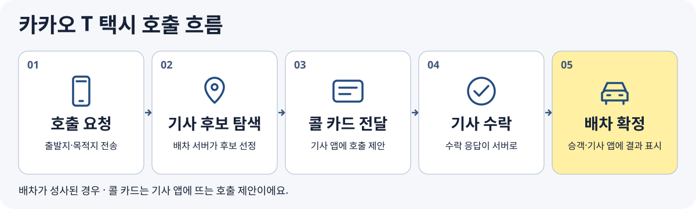

비가 오던 저녁, 재현은 카카오 T에서 택시를 불렀습니다. 지도에는 주변에 택시가 여러 대 보였지만, 바로 기사님이 정해지지는 않았습니다. 잠시 뒤 배차가 확정되자 차량 정보가 떴습니다.

가까운 곳에 택시가 있다면 왜 호출이 바로 성사되지 않을까요? 

재현이가 누른 버튼은 기사님 화면에 어떻게 도착하는 걸까요?

## 1. 승객의 앱이 탑승 요청을 보냅니다

재현이 출발지와 목적지를 확인하고 호출하면, 승객 앱은 탑승에 필요한 정보를 담아 서비스에 요청을 보냅니다. 요청을 보내는 앱을 **클라이언트**, 요청을 받아 처리하는 쪽을 **서버**라고 부릅니다.

이때 출발지의 점 하나가 중요합니다. 위치 신호가 건물 뒤편을 가리키는데 재현이 실제로는 큰길에서 기다리고 있다면, 기사님이 도착해야 할 지점부터 달라집니다. 앱에서 출발지를 확인하는 장면은 단순한 지도 조작처럼 보이지만, 실제로는 차량과 승객이 만날 곳을 정하는 일입니다.

## 2. 지도에서 가까워 보이는 차량과 호출을 받을 후보는 다릅니다

배차 시스템은 호출을 처리할 차량 후보를 찾아야 합니다. 지도에서 가까워 보이는 거리만 보면 맞은편에 있는 택시가 먼저 떠오릅니다. 하지만 도로에서 실제로 돌아오는 시간이 길거나, 기사님이 호출을 받기 어려운 상태일 수도 있습니다.

카카오모빌리티의 공개 설명은 일반 호출에서 기사에게 **콜 카드**를 발송하는 과정과, 예상 도착 시간이나 추천 방식이 배차에 쓰이는 사례를 소개합니다. 이 글에서는 공개 자료에 나온 흐름을 설명하며, 호출 유형과 시점에 따라 달라질 수 있는 후보 순서와 기준을 하나의 고정 규칙으로 가정하지 않습니다.

> 참고 : [카카오 T 택시 배차 시스템](https://www.kakaomobility.com/contents/taxi-dispatch), [카카오 기술윤리 보고서](https://www.kakaocorp.com/media/esg-resource/pdf/KakaoGroup_TechEthicsReport_2024.pdf)

## 3. 기사 앱에 콜 카드가 도착하고 수락이 돌아옵니다

후보 기사에게는 기사 앱을 통해 호출 제안인 콜 카드가 전달됩니다. 기사님은 제안을 보고 응답할 수 있습니다. 재현의 화면에서 보이는 ‘택시 찾는 중’은 승객에게는 한 가지 상태지만, 그동안 기사 쪽에서는 제안이 전달되고 응답을 기다리는 일이 진행됩니다.

카카오모빌리티는 기사에게 카드가 도착해도 응답하지 않는 경우와, 기사님이 수락했어도 배차가 확정되지 않는 경우를 설명합니다. 따라서 카드 전달과 수락, 최종 배차는 구분해서 볼 필요가 있습니다. 가까운 차량이 보이는데도 시간이 걸리는 상황에는 이렇게 여러 단계가 겹쳐 있을 수 있습니다. 

> 참고 : [카카오 T 택시 배차 시스템](https://www.kakaomobility.com/contents/taxi-dispatch)

## 4. 배차가 확정되면 두 앱은 같은 결과를 보여 줍니다

배차가 확정되면 승객과 기사는 같은 탑승 건을 각자의 화면에서 확인할 수 있어야 합니다. 승객에게 필요한 것은 어느 차량을 어디서 기다릴지이고, 기사에게 필요한 것은 어디로 가서 승객을 만날지입니다. 화면은 달라도 두 사람이 서로 다른 호출을 보고 움직이지 않도록 상태가 연결돼야 합니다.

호출을 기다리다 취소했거나 연결이 잠시 늦어진 경우를 생각하면, 이 차이가 더 잘 보입니다. 버튼을 눌렀다는 화면과 서버가 최종 상태를 정했다는 화면 사이에는 시차가 생길 수 있습니다. 재현이 차량 번호를 확인하고 큰길로 걸어 나가는 순간은, 처음 전송한 요청이 기사 앱의 제안과 응답을 거쳐 실제 만남으로 이어진 시점입니다.

[[terms]]
